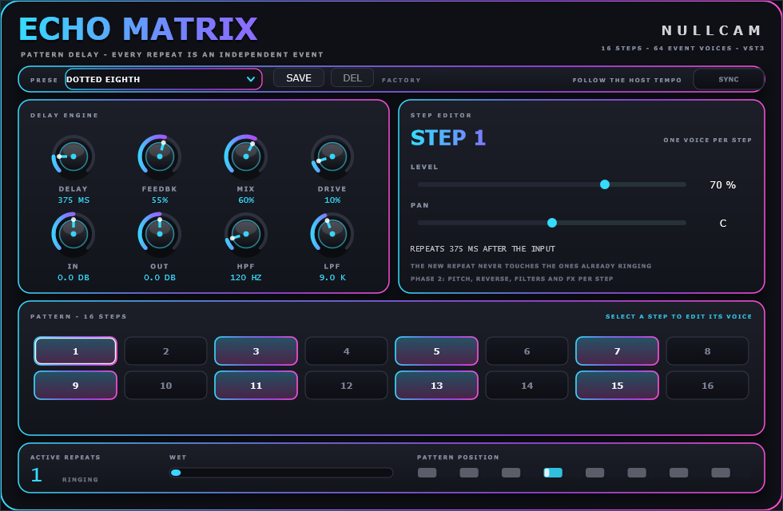

# EchoMatrixMode

**Echo Matrix Pattern Delay VST3 by NULLCAM.** Un delay a memoria con un sequenziale
a 16 passi: ogni passo attivo genera una **ripetizione indipendente**, con il suo
livello, il suo pan e la sua vita. Una ripetizione nuova non tocca mai quelle che
stanno già suonando.



---

## Cosa fa

L'input entra in una memoria circolare stereo. Il sequenziale gira a 16 passi e
ogni passo attivo **tocca la memoria**: il campione catturato in quel momento
diventa una voce autonoma, che aspetta il tempo di delay, si apre, suona per due
sedicesimi di pattern e muore.

Ogni voce ha il suo `LEVEL`, il suo `PAN`, la sua posizione di lettura e il suo
inviluppo. Nessuna ripetizione può alterare le altre: è il punto di tutto il
plugin. Il pool è limitato a 64 voci e, quando è pieno, la voce più vecchia
viene rubata a rotazione, così il costo CPU non cresce mai.

Il percorso globale è: `input → memoria → (filtri + drive nel loop di feedback)
→ mix dry/wet → uscita`.

La memoria riceve `ingresso + feedback filtrato`, letto al tempo di delay. Il
feedback viene applicato una volta sola, e passa attraverso un passa-alto, un
passa-basso e una saturazione `tanh`.

---

## I controlli

### Motore di delay

| Comando | Cosa fa |
|---|---|
| `DELAY` | tempo della ripetizione, da 50 ms a 2 s (ignorato quando `SYNC` è attivo) |
| `SYNC` | se acceso, il delay segue il tempo del host (una battuta) |
| `FEEDBK` | quanta parte del ritorno torna in memoria, da 0% a 99% |
| `MIX` | equilibrio tra sega e riverbero |
| `DRIVE` | saturazione nel loop di feedback |
| `IN` / `OUT` | gain di ingresso e di uscita, in dB |
| `HPF` / `LPF` | passa-alto e passa-basso del loop di feedback |

### Sequenziale

I 16 pad sono i passi del pattern. Un passo acceso fa partire una ripetizione.
Clicca un pad per selezionarlo e modificarlo.

| Comando | Cosa fa |
|---|---|
| `LEVEL` (per passo) | livello della ripetizione di quel passo, da 0% a 100% |
| `PAN` (per passo) | posizione stereo della ripetizione: `L`, `C` o `R` |

Il pannello mostra in tempo reale quante ripetizioni stanno suonando
(`ACTIVE REPEATS`), il livello del riverbero (`WET`) e la posizione nel pattern
(`PATTERN POSITION`, con la testina che corre sotto i 16 passi).

Tutti i comandi sono automatizzabili e finiscono nel progetto della DAW.

---

## Preset

- **Factory** (8): `DOTTED EIGHTH`, `PING PONG`, `DUB`, `TAPE ECHO`, `GLITCH TAP`,
  `AMBIENT WASH`, `SLAPBACK`, `CHAOTIC`.
- **Utente**: `SAVE` scrive un file XML per preset nella cartella preset, `DEL` lo
  cancella. Il progetto DAW salva automaticamente i comandi.

### Cartelle preset

```
Windows   %APPDATA%\NULLCAM\ECHOMATRIX-MODE\presets
macOS     ~/Library/Application Support/NULLCAM/ECHOMATRIX-MODE/presets
```

Un file `.xml` per preset, leggibile: puoi copiarlo, salvarlo o mandarlo a un amico.

---

## Build

Serve Visual Studio 2022 (carico "Sviluppo di applicazioni desktop con C++"), CMake e
un checkout di JUCE (scaricato al primo configure).

```bat
build-windows.bat
```

oppure a mano:

```bat
cmake -B build -G "Visual Studio 17 2022" -A x64
cmake --build build --config Release --target EchoMatrixMode_VST3
```

Con JUCE già presente:

```bat
cmake -B build -G "Visual Studio 17 2022" -A x64 -DJUCE_DIR=C:\percorso\JUCE
```

Il `.vst3` viene copiato automaticamente nella cartella VST3 scrivibile: quella di
sistema se il build gira come amministratore, altrimenti
`%LOCALAPPDATA%\Programs\Common\VST3`.

## Test

Il motore DSP è indipendente da JUCE e ha i suoi test:

```bat
cmake --build build --config Release --target echomatrix_dsp_test
build\Release\echomatrix_dsp_test.exe
```

Controlla: la ripetizione arriva esattamente un tempo di delay dopo l'ingresso, il
sequenziale decide quali ripetizioni esistono, una ripetizione nuova non altera
quelle già in corso, il pan resta stereo, il feedback continua a suonare, il mix a
zero è un pass-through pulito, il sync segue il tempo del host, il silenzio resta
silenzio, l'output non diventa mai NaN e il pool di voci non cresce oltre 64.

Per vedere il pannello senza DAW (e verificare preset, stato e read-out):

```bat
cmake --build build --config Release --target echomatrix_ui_check
build\echomatrix_ui_check_artefacts\Release\echomatrix_ui_check.exe panel.png 2
```

E per provare a caricare il `.vst3` costruito come fa un host (JUCE apre il
bundle, parla con la factory e crea un'istanza vera):

```bat
cmake --build build --config Release --target echomatrix_vst3_check
build\echomatrix_vst3_check_artefacts\Release\echomatrix_vst3_check.exe
```

Controlla: il bundle dichiara un plugin solo, il maker è `NULLCAM`, l'ingresso e
l'uscita sono stereo, i 58 parametri sono esposti, l'uscita non diventa mai NaN
e il delay ripete davvero.

## Struttura

```
Source/EchoMatrixEngine.h  motore: memoria, sequenziale, voci indipendenti, feedback (nessuna dipendenza da JUCE)
Source/PluginProcessor.*   parametri, 8 preset factory, preset XML utente, stato, BPM del host
Source/PluginEditor.*      il pannello (Look and Feel, manopole, 16 pad, step editor, meter)
tests/dsp_test.cpp          test del motore (17 controlli)
tests/ui_check.cpp          render del pannello + round trip preset/stato + read-out
tests/vst3_check.cpp        il VST3 costruito, caricato e fatto suonare
```

## Note

- Il motore è senza allocazioni sul thread audio: memoria, voci e filtri sono
  preparati in `prepare()` e non crescono mai durante il playback.
- La voce rubata è sempre la più vecchia del pool, con rubatura a rotazione: il
  costo resta costante anche con tutti i 16 passi attivi.
- Il sync segue il BPM che il host comunica; senza host (o senza trasporto) resta
  il tempo manuale.
- Fase 1: il pannello annuncia già `PHASE 2` per pitch, reverse, filtri e FX per
  passo. Oggi quei comandi non ci sono: ogni passo ha solo `LEVEL` e `PAN`.
- Il codice è AGPLv3 (JUCE è AGPLv3).
