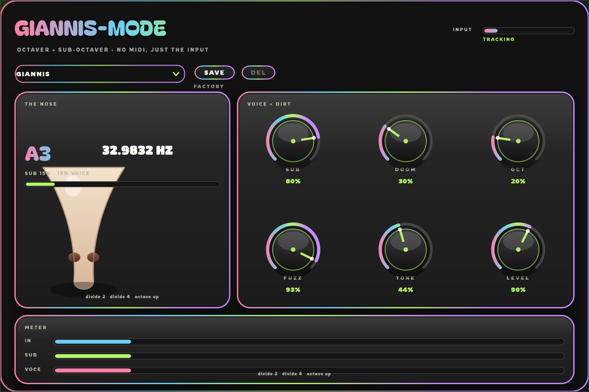

# GIANNIS-MODE

**Octaver + sub octaver VST3 by NULLCAM.** Nessun MIDI: entri con il basso (o la chitarra) e il plugin ti restituisce la nota un'ottava sotto (`SUB`), due ottave sotto (`DOOM`), più un'ottava sopra (`OCT`) con il carattere immediato di un raddoppio a frequenza raddoppiata. Tutto passa attraverso un fuzz con tono e livello.

I dodici preset coprono lo spettro: dal sub dubstep violento al synth octaver semplice e pastoso.



---

## Cosa fa

Il tuo input passa in un **divider analogico**: un passa-basso a 320 Hz toglie le armoniche che incrociano lo zero, uno Schmitt trigger lo trasforma in onda quadra, e due flip-flop lo dividono per 2 (`SUB`) e per 4 (`DOOM`). Ogni voce sub è arrotondata da un filtro SVF a 4 poli che segue la nota (cutoff ≈ 2.4–2.6× la frequenza suonata) e passata per un tanh, così resta piena anche sulle note gravi.

L'ottava sopra (`OCT`) è un raddoppio a piena frequenza: full-wave rectifier sulla secca, attacco identico a quello della nota, DC-blockato e levigato a 7 kHz.

Il percorso: `voce = secca + ottava sopra` → fuzz (tanh, drive `1 + fuzz × 40`, compressione `1 / (1 + fuzz × 0.55)`) → filtro passa-basso a 2 poli `TONE` (150 Hz × 46^tone) → somma `+ SUB + DOOM` → ginocchio trasparente a 0.80 → livello.

La secca è sempre a unità (`dry = 1.0`, non è un comando): resta un pedale, non un sintetizzatore. `TONE` modella solo il percorso fuzzato/voce, i sub restano puliti e grandi.

---

## I controlli

| Comando | Cosa fa |
|---|---|
| `SUB` | livello della voce un'ottava sotto (0% = spenta) |
| `DOOM` | livello della voce due ottave sotto (0% = spenta) |
| `OCT` | livello dell'ottava sopra (0% = spenta) |
| `FUZZ` | drive sulla voce: da pulita a satura |
| `TONE` | filtro passa-basso sulla voce fuzzata, da scuro a brillante |
| `LEVEL` | gain finale, a zero è muto |

Il pannello mostra anche: la nota che il divider sta seguendo (grande, nel nasone), la frequenza in Hz, le barre di livello `IN`, `SUB`, `VOCE`, e la legenda `divide 2 / divide 4 / octave up`.

---

## Preset

- **Factory** (12): `GIANNIS`, `SUB ZERO`, `DUBSTEP`, `DOOM`, `FUZZ OCT`, `SYNTH BASS`, `CLEAN OCT`, `QUAKE`, `WUB`, `ORGAN`, `TAPE OCT`, `SUBSONIC`.
- **Utente**: `SAVE` scrive un file XML per preset nella cartella preset, `DEL` lo cancella. Il progetto DAW salva automaticamente i comandi.

### Cartelle preset

```
Windows   %APPDATA%\NULLCAM\GIANNIS-MODE\presets
macOS     ~/Library/Application Support/NULLCAM/GIANNIS-MODE/presets
```

Un file `.xml` per preset, leggibile: puoi copiarlo, salvarlo o mandarlo a un amico.

---

## Build

Serve Visual Studio 2022 (carico "Sviluppo di applicazioni desktop con C++"), CMake e
un checkout di JUCE (scaricato al primo configure).

```bat
build-windows.bat
```

oppure a mano:

```bat
cmake -B build -G "Visual Studio 17 2022" -A x64
cmake --build build --config Release --target GiannisMode_VST3
```

Con JUCE già presente:

```bat
cmake -B build -G "Visual Studio 17 2022" -A x64 -DJUCE_DIR=C:\percorso\JUCE
```

Il `.vst3` viene copiato automaticamente nella cartella VST3 scrivibile: quella di
sistema se il build gira come amministratore, altrimenti
`%LOCALAPPDATA%\Programs\Common\VST3`.

## Test

Il motore DSP è indipendente da JUCE e ha i suoi test:

```bat
cmake --build build --config Release --target giannis_dsp_test
build\Release\giannis_dsp_test.exe
```

Controlla: divisione per 2 e per 4, ottava sopra, passthrough pulito, silenzio,
fuzz che satura senza uscire dai binari, limiter, blocco del DC, follower della nota,
letture del pannello.

Per vedere il pannello senza DAW (e verificare preset e stato):

```bat
cmake --build build --config Release --target giannis_ui_check
build\giannis_ui_check_artefacts\Release\giannis_ui_check.exe panel.png 2
```

## Struttura

```
Source/GiannisEngine.h   motore: divider, SVF, subs, rectifier, fuzz, limiter (nessuna dipendenza da JUCE)
Source/PluginProcessor.* parametri, 12 preset factory, preset XML utente, stato
Source/PluginEditor.*    il pannello (Look and Feel, nasone, manopole, meter)
Source/Fonts/            Bagel Fat One, Rowdies Bold/Regular, Titan One (SIL OFL)
tests/dsp_test.cpp       test del motore (17 gruppi)
tests/ui_check.cpp       render del pannello + round trip preset/stato
```

## Note

- Il dry è sempre a unità: il plugin resta un pedale, non un sintetizzatore.
- I sub condividono un unico DC-blocker: un divider che si ferma su una nota tenuta
  non lascia offset costante sull'uscita.
- `TONE` modella solo il percorso voce/fuzz: i sub restano puliti e grandi anche a
  volume basso, grazie a una compressione d'ingresso `min(1, body × 4.5)`.
- Non serve routing MIDI: l'ingresso audio della traccia è già l'informazione che serve.
- I font sono SIL OFL (`Source/Fonts/OFL.txt`). Il codice è AGPLv3.
