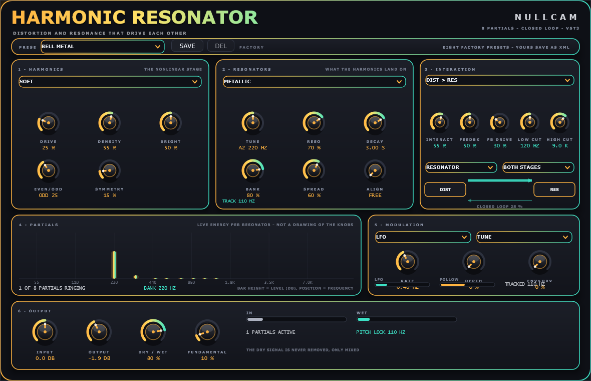

# HarmonicResonatorMode

**Interactive Distortion + Resonator Bank VST3 by NULLCAM.** Una distorsione e una
banca di risonatori che **si guidano a vicenda**: le armoniche che la
distorsione crea cadono sui partiali, i partiali tornano dentro la distorsione,
e il loop tra i due è un comando, non un effetto collaterale.



---

## Cosa fa

L'input passa prima attraverso uno stadio non lineare, poi dentro una banca di
**8 risonatori** (band-pass TPT-SVF). Il punto del plugin è il **ritorno**:
quello che esce dalla banca viene reiniettato nello stadio di distorsione, e
viceversa.

- `INTERACTION` **non è un wet/dry**: è la quantità di segnale che fa il giro
  del loop. A zero il plugin è una catena lineare, a 100 il loop è chiuso e
  la nota si autoalimenta.
- `FEEDBACK` decide quanto del ritorno viene tenuto nel giro.
- `ROUTING` sceglie il percorso: `DIST > RES` (solo in avanti), `RES > DIST`
  (solo la banca torna indietro) o `RES < > DIST` (il loop chiuso, il default).
- `FB SOURCE` sceglie **cosa** viene reiniettato: la banca, la distorsione, il
  segnale pulito, la somma dei due o solo la banda.
- `FB DEST` sceglie **dove** il ritorno atterra: in entrambi gli stadi, solo
  nella distorsione o solo nella banca.

Il ritorno passa attraverso un passa-alto, un passa-basso e una saturazione
`tanh`: il loop può diventare instabile di proposito, ma resta **limitato** e
non esplode mai.

Il percorso globale è:
`input → distorsione → banda → (ritorno → distorsione) → mix dry/wet → uscita`.

---

## I controlli

### Stadio non lineare

| Comando | Cosa fa |
|---|---|
| `SHAPE` | la curva: `SOFT`, `HARD`, `FOLD`, `ASYM`, `CHEBY`, `CRUSH`, `RING` |
| `DRIVE` | quanto il segnale viene spinto dentro la curva |
| `DENSITY` | quante armoniche la curva genera (`CHEBY` sceglie anche l'ordine) |
| `BRIGHT` | tilt del tono dopo la distorsione |
| `EVEN / ODD` | bilancia le armoniche pari e dispari |
| `SYMMETRY` | quanto le due metà della curva sono diverse |

`EVEN / ODD` è un interruttore continuo, non un interruttore: a sinistra solo
dispari, a destra solo pari. La parte "pari" è la stessa curva alimentata con
il valore assoluto del segnale, quindi è pari per costruzione.

### Banca di risonatori

| Comando | Cosa fa |
|---|---|
| `TUNING` | `HARMONIC`, `ODD`, `EVEN`, `CHORD`, `METALLIC` |
| `TUNE` | la frequenza base della banca |
| `RESO` | quanto i partiali sono selettivi (il Q) |
| `DECAY` | quanto tempo suona ogni partial (T60) |
| `BANK` | il livello della banca |
| `SPREAD` | quanto i partiali si allontanano dalla serie Armonica |
| `ALIGN` | fa seguire la base della banca alla nota che suona |

`ALIGN` usa un tracker di pitch (autocorrelazione su un segnale decimato): la
banca si sposta sulla fondamentale che sente e ci resta per qualche secondo
anche quando la nota finisce, così la coda non viene risweptata.

### Loop e feedback

| Comando | Cosa fa |
|---|---|
| `ROUTING` | `DIST > RES`, `RES > DIST`, `RES < > DIST` |
| `INTERACT` | quanto segnale fa il giro del loop |
| `FEEDBK` | quanto ritorno viene tenuto |
| `FB DRIVE` | saturazione sul ritorno |
| `LOW CUT` / `HIGH CUT` | filtro del ritorno |
| `FB SOURCE` | cosa viene reiniettato |
| `FB DEST` | dove il ritorno atterra |

### Modulazione

| Comando | Cosa fa |
|---|---|
| sorgente | `LFO`, `RANDOM`, `S & H`, `ENVELOPE` |
| destinazione | `TUNE`, `RESONANCE`, `DECAY`, `DRIVE`, `INTERACTION`, `PAN` |
| `RATE` | velocità della modulazione |
| `DEPTH` | quanto la modulazione muove la destinazione |
| `ENV>DRV` | quanto l'inviluppo del segnale spinge il drive |

### Uscita

| Comando | Cosa fa |
|---|---|
| `INPUT` / `OUTPUT` | gain di ingresso e di uscita, in dB |
| `DRY / WET` | equilibrio fra il segnale pulito e il trattamento |
| `FUNDAMENTAL` | l'inviluppo segue la fondamentale (0 = lo segue sempre) |

Tutti i comandi sono automatizzabili e finiscono nel progetto della DAW.

---

## Il pannello

La card `PARTIALS` **non è un disegno**: le barre vengono dal motore.

- **posizione** = la frequenza reale del partial (asse logaritmico 40 Hz - 16 kHz)
- **altezza** = il livello di quel partial, in dB
- `1 OF 8 PARTIALS RINGING` = quanti partiali stanno suonando in questo momento

La card `INTERACTION` disegna il loop: le due frecce (avanti e ritorno) si
allargano e si illuminano con `INTERACT` e `FEEDBACK`, e le due scatole
`DIST` / `RES` mostrano il routing scelto.

---

## Preset

- **Factory** (8): `BELL METAL`, `TUBE CHOIR`, `IRON GONG`, `GLASS HARMONICS`,
  `SUB ANCHOR`, `WRECKED RADIO`, `RESONANT FOLD`, `PITCH LOCK`.
- **Utente**: `SAVE` scrive un file XML per preset nella cartella preset, `DEL` lo
  cancella. Il progetto DAW salva automaticamente i comandi.

### Cartelle preset

```
Windows   %APPDATA%\NULLCAM\HARMONIC-RESONATOR-MODE\presets
macOS     ~/Library/Application Support/NULLCAM/HARMONIC-RESONATOR-MODE/presets
```

Un file `.xml` per preset, leggibile: puoi copiarlo, salvarlo o mandarlo a un amico.

---

## Build

Serve Visual Studio 2022 (carico "Sviluppo di applicazioni desktop con C++"), CMake e
un checkout di JUCE (scaricato al primo configure).

```bat
cmake -B build -G "Visual Studio 17 2022" -A x64
cmake --build build --config Release --target HarmonicResonatorMode_VST3
```

Con JUCE già presente:

```bat
cmake -B build -G "Visual Studio 17 2022" -A x64 -DJUCE_DIR=C:\percorso\JUCE
```

Il `.vst3` viene copiato automaticamente nella cartella VST3 scrivibile: quella di
sistema se il build gira come amministratore, altrimenti
`%LOCALAPPDATA%\Programs\Common\VST3`.

## Test

Il motore DSP è indipendente da JUCE e ha i suoi test:

```bat
cmake --build build --config Release --target harmonicresonator_dsp_test
build\Release\harmonicresonator_dsp_test.exe
```

Controlla: il silenzio resta silenzio anche con il loop spalancato, `DRIVE`
genera armoniche, la modalità dispari tiene bassa la seconda armonica e quella
pari la fa dominare, `EVEN / ODD` cambia davvero il contenuto armonico, le
sette curve restano dentro i limiti, la banca suona alla frequenza giusta e
sulle sue parziali, il tuning `ODD` lascia fuori le parziali pari, il tuning
`METALLIC` è inharmonico, una coda lunga suona più a lungo di una corta, il
loop chiuso continua a suonare **dopo** che la nota è finita e produce
intermodulazione che una semplice miscelazione non produrrebbe, i due routing
sono percorsi diversi, 105 combinazioni estreme non esplodono mai, il tracker
trova la fondamentale e `ALIGN` sposta la banca sulla nota, la modulazione
muove davvero la banca, la banca è accordata e limitata a 44.1, 48, 88.2, 96 e
192 kHz e il risultato **non cambia con la dimensione del blocco audio**.

Per vedere il pannello senza DAW (e verificare preset, stato e read-out):

```bat
cmake --build build --config Release --target harmonicresonator_ui_check
build\harmonicresonator_ui_check_artefacts\Release\harmonicresonator_ui_check.exe panel.png 2
```

E per provare a caricare il `.vst3` costruito come fa un host (JUCE apre il
bundle, parla con la factory e crea un'istanza vera):

```bat
cmake --build build --config Release --target harmonicresonator_vst3_check
build\harmonicresonator_vst3_check_artefacts\Release\harmonicresonator_vst3_check.exe
```

Controlla: il bundle dichiara un plugin solo, il maker è `NULLCAM`, l'ingresso e
l'uscita sono stereo, i 30 parametri sono esposti, l'uscita non diventa mai NaN
e i risonatori continuano a suonare dopo che l'ingresso è finito.

## Struttura

```
Source/HarmonicResonatorEngine.h  motore: curve, banca di risonatori, tracker di pitch, loop (nessuna dipendenza da JUCE)
Source/PluginProcessor.*           parametri, 8 preset factory, preset XML utente, stato
Source/PluginEditor.*              il pannello (Look and Feel, manopole, display dei partiali, schema del loop)
tests/dsp_test.cpp                  test del motore
tests/ui_check.cpp                  render del pannello + round trip preset/stato + read-out
tests/vst3_check.cpp                il VST3 costruito, caricato e fatto suonare
```

## Note

- Il motore è senza allocazioni sul thread audio: buffer, filtri e risonatori
  sono preparati in `prepare()` e non crescono mai durante il playback.
- Il loop è chiuso di proposito: con `INTERACTION` e `FEEDBACK` alti il
  plugin si autoalimenta. È limitato in modo duro (saturazione sul ritorno e
  limiter in uscita), mai in modo morbido.
- La coda dei risonatori sopravvive alla nota: il tracker mantiene la
  confidenza per qualche secondo, così `ALIGN` non risweepa la banca mentre
  suona la coda.
- Il codice è AGPLv3 (JUCE è AGPLv3).
