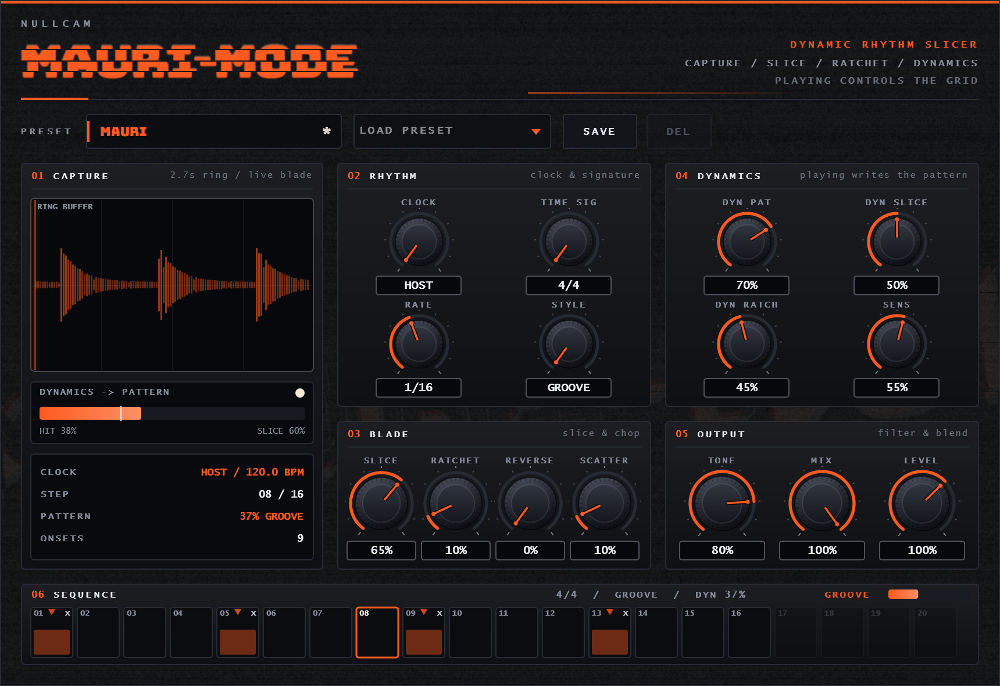

# MAURI-MODE

**Rhythm slicer VST3 by NULLCAM.** Come un Boss Slicer, ma il pattern non è scritto
a mano: lo genera **la dinamica dello strumento che stai suonando**.



---

## Cosa fa

MAURI-MODE ascolta l'ingresso, lo divide in fette e le riarrangia in una sequenza.
Gli step "live" sono **chop in tempo reale a latenza zero** (l'audio che suoni passa
attraverso il gate del ritmo, senza buffer), mentre ratchet, reverse, scatter e hold
pescano dal ring buffer di 2.7 secondi.

Il pezzo forte è un altro: **scegli una time signature e uno stile, poi suona**.
La dinamica riscrive il pattern in tempo reale.

| Dinamica | Pattern generato |
|---|---|
| piano, morbido | solo i tempi forti: un pulse secco |
| medio | groove con contratiempo |
| forte | sedicesimi, sincopi, ratchet |
| fortissimo | shuffle pieno: ratchet, scatter, reverse, hold |

Non serve toccare l'interfaccia, non serve un pedale esterno: basta suonare più forte.

## I controlli

**02 RHYTHM**

| Knob | Cosa fa |
|---|---|
| CLOCK | `HOST` (tempo del DAW), `INPUT` (il playing è il clock: ogni transient parte uno step), `FREE` (120 BPM interno) |
| TIME SIG | `4/4`, `3/4`, `5/4`, `2/4`, `6/8`, `5/8`, `7/8`, `9/8` - decide la lunghezza della battuta e gli accenti metrici |
| RATE | divisione dello step: `1/4`, `1/8`, `1/8T`, `1/16`, `1/16T`, `1/32`, `1/32T`, `1/64` |
| STYLE | come viene scritto il pattern: `GROOVE`, `EUCLID`, `SYNCOP`, `ROLL`, `GHOST`, `BACK`, `TREM`, `INVERT` |

**03 BLADE** (la lama)

| Knob | Cosa fa |
|---|---|
| SLICE | lunghezza della fetta, in percentuale dello step |
| RATCHET | quanti ratchet dentro lo step |
| REVERSE | probabilità di suonare la fetta al contrario |
| SCATTER | probabilità di prendere un pezzo a caso dal ring buffer |

**04 DYNAMICS** (la parte che scrive il ritmo)

| Knob | Cosa fa |
|---|---|
| DYN PAT | quanto la dinamica può riscrivere il pattern: 0% = groove fisso, 100% = dal pulse allo shuffle |
| DYN SLICE | quanto più forte suoni, più corte diventano le fette |
| DYN RATCH | quanto più forte suoni, più ratchet si aggiungono |
| SENS | sensibilità del follower di dinamica e dei transienti |

**05 OUTPUT**

| Knob | Cosa fa |
|---|---|
| TONE | filtro passa-basso del segnale processato |
| MIX | dry / wet |
| LEVEL | gain finale |

**01 CAPTURE** mostra il ring buffer, la testa di lettura, il livello della dinamica e
lo stato del sequencer. **06 SEQUENCE** è la griglia: 20 celle, le celle attive
mostrano il pattern **live** (cambia mentre suoni), i triangolini sono gli accenti
metrici, i trattini bianchi i ratchet.

Ogni knob ha un display numerico: si può **scrivere il valore esatto** (clic sul
numero e digita, per esempio `7/8`, `GROOVE`, `65%`).

## Preset

- **Factory**: `MAURI`, `ODD 7/8`, `GHOST 5/4`, `SHRED 6/8`.
- **Utente**: il pulsante `SAVE` scrive un file XML per preset in
  `%APPDATA%\NULLCAM\MAURI-MODE\presets` (un file per preset, quindi sopravvivono a
  reinstallazioni, backup e passaggi di macchina). `LOAD PRESET` li riapre, `DEL`
  li cancella.
- Il progetto DAW salva automaticamente tutti i knob.

## Build

Serve Visual Studio 2022 (carico "Sviluppo di applicazioni desktop con C++"), CMake
e un checkout di JUCE (viene scaricato automaticamente al primo configure).

```bat
build-windows.bat
```

oppure a mano:

```bat
cmake -B build -G "Visual Studio 17 2022" -A x64
cmake --build build --config Release --target MauriMode_VST3 MauriMode_Standalone
```

Se hai già JUCE da qualche parte, salta il download:

```bat
cmake -B build -G "Visual Studio 17 2022" -A x64 -DJUCE_DIR=C:\percorso\JUCE
```

Il `.vst3` viene copiato automaticamente nella cartella VST3 scrivibile: quella di
sistema se il build gira come amministratore, altrimenti
`%LOCALAPPDATA%\Programs\Common\VST3`.

## Test

```bat
cmake --build build --config Release --target mauri_dsp_test
build\Release\mauri_dsp_test.exe
```

25 controlli sul motore: silenzio, passthrough, gain, clock da host e da input,
time signature, densità del pattern in funzione della dinamica, tier di complessità,
slice più corte quando suoni forte, chop live.

Per vedere il pannello senza DAW:

```bat
cmake --build build --config Release --target mauri_ui_check
build\mauri_ui_check_artefacts\Release\mauri_ui_check.exe panel.png 2
```

## Struttura

```
Source/MauriEngine.h      il motore: nessuna dipendenza da JUCE, gira anche nei test
Source/PluginProcessor.*  parametri, clock del host, preset XML
Source/PluginEditor.*     il pannello
tests/dsp_test.cpp        test del motore
tests/ui_check.cpp        render del pannello + round trip dei preset
```

I font (Bungee, Bungee Shade) sono SIL OFL e viaggiano dentro il binario.

## Note

- Il tempo del DAW viene letto tramite `getPlayHead()`: se il DAW non invia il BPM
  si usa 120.
- Con `CLOCK = INPUT` il ritmo segue i transienti dello strumento, quindi puoi
  suonare il pattern a mano e il plugin lo quantizza.
- `MIX = 0` è un passthrough pulito: utile per verificare il dry.
