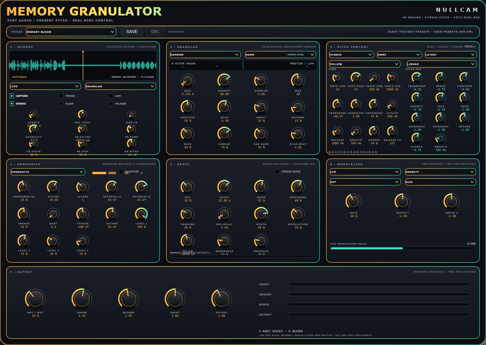

# MemoryGranulatorMode

**Strumento VST3 a memoria circolare e nuvole granulari by NULLCAM.** Il
plugin registra l'audio che riceve in una memoria circolare, lo congela e lo
riapre in grani indipendenti. MIDI e pitch audio controllano la stessa musica
senza media cieca: la nota decide l'altezza, la velocità decide *dove* nel
materiale registrato viene letto il grano.



> **Serve un segnale audio.** MemoryGranulatorMode è un VST3 effetto con
> ingresso audio e ingresso MIDI: le note non creano il materiale sorgente,
> ma lo controllano. Fai entrare un suono nella memoria, poi usa MIDI per
> cambiare i grani che escono da quella memoria.

---

## Cosa fa

Il percorso principale è:

```text
input audio → memoria circolare → nuvola di grani → spazio/reverb → uscita
                    ↑               ↑                  ↑
                    └── feedback ───┘             modulazione
```

- la **memoria circolare** scrive continuamente finché `CAPTURE` è attivo e
  continua a girare quando la lunghezza è piena;
- `FREEZE` conserva i campioni scritti: la sorgente non cambia più;
- i **grani** leggono piccole finestre della memoria con durata, posizione,
  inviluppo, senso di lettura, pan e pitch propri;
- `SCAN` sposta il playhead della memoria e le posizioni di lettura, ma **non
  cambia il pitch**;
- il **pitch** di un grano è un rapporto di frequenza indipendente dalla
  velocità di playback;
- l'evoluzione della memoria può essere riscritta dal feedback, con filtro,
  damping, saturazione, diffusione e pitch;
- lo **spazio finale** aggiunge una riverberazione integrata, filtro e
  feedback spaziale.

Ogni controllo visibile è collegato al DSP. Il gate
`memorygranulator_parameter_coverage_check` verifica automaticamente che i 99
parametri pubblici, le 99 specifiche VST3, i 99 controlli UI e i campi del
motore restino allineati e che ogni campo venga realmente letto.

---

## Memoria ed evoluzione

| Controllo | Funzione |
|---|---|
| `MEMORY LENGTH` | lunghezza circolare della memoria, da 0,25 a 30 secondi |
| `CAPTURE` | scrive l'ingresso nella memoria |
| `FREEZE` | blocca la memoria: i campioni registrati non vengono più sovrascritti |
| `ARM` / `RELEASE` | arm e fine cattura per la modalità `CAPTURE+RELEASE` |
| `CLEAR` | azzera memoria, playhead e grani attivi |
| `MEMORY MODE` | `LIVE`, `FREEZE`, `CAPTURE+RELEASE`, `OVERDUB`, `HOLD` |
| `REC LEVEL` | livello scritto in memoria |
| `STEREO` | mantiene i due canali separati oppure registra in mono |
| `MEM FB` | quantità di feedback riscritto nella memoria |
| `FB SOURCE` | `INPUT`, `GRANULAR`, `REVERB`, `COMBINED`, `FILTERED` |
| `FB STABILITY` | quanto il contenuto precedente resta nel punto di overdub |
| `FB FILTER` / `FB DAMP` | filtro e smorzamento del ritorno |
| `FB DRIVE` / `FB DIFF` | saturazione e diffusione del feedback |
| `FB PITCH` | ritardo con pitch del feedback, in semitoni |

`FREEZE` e `HOLD` non sono la stessa cosa: `FREEZE` conserva la memoria
immutabile; `HOLD` blocca la cattura dell'ingresso ma lascia il feedback
riscriverla, così il materiale può ancora evolvere.

---

## Motore granulare

`GRAIN MODE` offre otto generatori realmente diversi:

- `UNIFORM` — posizioni distribuite intorno al playhead;
- `RANDOM` — posizioni libere nella memoria;
- `CLUSTER` — piccoli gruppi sparsi;
- `RHYTHMIC` — griglia di otto posizioni, con `TEMPO SYNC`;
- `CLOUD` — distribuzione continua e densa;
- `SPARSE` — pochi grani, molto distanziati;
- `SCAN` — posizione inseguita dal playhead;
- `PITCH-AWARE` — la posizione segue la nota/tracking.

I controlli principali sono `GRAIN SIZE`, `DENSITY`, `OVERLAP`, `MAX GRAINS`,
`POSITION`, `SCAN SPEED`, `SPRAY`, `REVERSE`, `STEREO SPREAD`, `PAN RANDOM`,
`GRAIN GAIN`, inviluppo (`HANN`, `EXP`, `TRIANGLE`, `PLATEAU`) e
`SCAN MULTIPLIER`.

Il `SCAN MULTIPLIER` scala la velocità del playhead; non è un controllo di
pitch. Il pitch di ciascun grano si muove a frequenza reale, così C4 e C5
restano due altezze distinte anche quando il materiale registrato è identico.

---

## Controllo del pitch

### MIDI

`PITCH SOURCE = MIDI` usa il vero event bus MIDI del VST3:

- note-on e note-off;
- polifonia: più note e accordi sono contemporaneamente attivi;
- priorità `LATEST`, `LOWEST`, `HIGHEST` o `VELOCITY`;
- filtro del canale MIDI (`OMNI` oppure canale 1–16);
- filtro dell'intervallo di note (`NOTE LOW` / `NOTE HIGH`);
- velocity, che scala il gain dei grani;
- aftertouch e pitch wheel;
- CC di rilascio configurabile (`RELEASE CC`, 64 per default).

Al note-off la voce viene rilasciata, ma i grani già nati continuano la loro
vita e la coda può restare nella memoria.

### Audio

`PITCH SOURCE = AUDIO` usa un tracker **monofonico** mediante
autocorrelazione. Sono regolabili l'intervallo di ricerca, la soglia di
confidenza, attack, release e smoothing. Il pannello mostra frequenza e
confidenza reali.

Il tracking polifonico è deliberatamente escluso: un detector FFT multi-picco
sbaglierebbe spesso le note simultanee e produrrebbe salti musicali. Il
tracker monofonico è invece testato su un tono reale.

### Hybrid

`PITCH SOURCE = HYBRID` mantiene la **nota MIDI come ancoraggio musicale** e
usa il pitch audio per il movimento secondario. Non fa una media aritmetica
tra due fonti incompatibili: se MIDI è presente, MIDI definisce l'altezza;
l'audio resta un segnale di controllo per la mappa e per il routing.

`FOLLOW MODE` sceglie come la nota agisce:

- `FOLLOW` — la nota segue il pitch del grano;
- `HARMONIC` — rapporto armonico;
- `INTERVAL` — intervalli configurabili;
- `RESONANT` — il filtro spaziale segue la frequenza di riferimento;
- `LOOSE` — piccola deviazione casuale;
- `FREE` — nessun follow automatico.

---

## Matrice pitch → grani

La matrice prende la posizione di pitch normalizzata e la manda a dieci
destinazioni: transpose, speed, position, density, size, rate, harmonic,
resonant, reverb e stereo.

Ogni profondità è **con segno**:

- il segno è la polarità (sopra/sotto, avanti/indietro, stretto/largo);
- il modulo è quanto il parametro viene spostato;
- `MAP CURVE` sceglie `LINEAR`, `EXP` o `LOG`;
- `MAP SMOOTH` evita discontinuità quando il pitch si muove.

---

## Organizzazione armonica

`HARMONIC LAYERS` crea da uno a quattro strati realmente simultanei. Ogni
strato ha una propria massa armonica e il proprio pan relativo.

- `FUNDAMENTAL` bilancia la fondamentale;
- `OCTAVE` bilancia il livello ottava;
- `INTERVAL A` e `INTERVAL B` definiscono le relazioni;
- `LEVEL 1`…`LEVEL 4` controllano i quattro strati;
- `HARMONIC SPREAD` disperde il detune;
- `QUANTIZE`, `SCALE` e `ROOT` quantizzano MIDI e audio su dodici scale;
- `TUNING` e `DETUNE` aggiungono regolazioni in centesimi.

---

## Spazio, modulazione e uscita

Lo spazio finale comprende dimensione, decadimento, diffusione, damping,
pre-delay, larghezza stereo, modulazione, filtro, risonanza e feedback. Il
feedback del reverb ha gain staging dedicato: anche con valori estremi la
catena resta finita.

La modulazione ha due corsie indipendenti. `MOD SOURCE 1/2` offre `LFO`,
`ENVELOPE`, `INPUT`, `VELOCITY`, `AFTERTOUCH`, `PITCH`, `RANDOM`, `S&H`,
`TEMPO` e `FEEDBACK`; `MOD DEST 1/2` può indirizzare size, density, position,
rate, speed, pitch, spread, decay, diffusion, feedback, filter e resonance.

In uscita, `DRY / WET` è un vero crossfade: a zero esce soltanto il dry, a
100 soltanto il trattamento. `GRAIN`, `REVERB`, `INPUT` e `OUTPUT` sono livelli
separati.

---

## Il pannello

Le sette card non sono decorazioni:

- **waveform/playhead** mostra i campioni reali della memoria e la posizione
  corrente del playhead;
- **grain positions** mostra le posizioni e la vita dei grani attivi;
- **active notes/pitch** mostra note MIDI, pitch controllato, Hz tracciati e
  confidenza;
- **harmonic levels** mostra il peso delle armoniche;
- **feedback meter** mostra l'attività del feedback della memoria;
- **modulation meter** mostra le due corsie in tempo reale;
- **output meters** mostrano ingresso e uscita.

---

## Preset

Factory preset inclusi:

1. `MEMORY BLOOM`
2. `CHORD ECHO`
3. `FROZEN VERB`
4. `OVERDUB CLOUD`
5. `HARMONIC WEATHER`
6. `POLY RHYTHM`
7. `RESONANT CIRCUIT`
8. `DARK ARCHIVE`

I preset utente sono file XML:

```text
Windows   %APPDATA%\NULLCAM\MEMORY-GRANULATOR-MODE\presets
macOS     ~/Library/Application Support/NULLCAM/MEMORY-GRANULATOR-MODE/presets
```

`SAVE` scrive il preset, `DEL` lo cancella. Il progetto DAW salva
automaticamente i 99 parametri.

---

## Ableton Live: instradamento MIDI

1. Crea una **traccia MIDI** con le note e scegli la sorgente MIDI nella
   sezione `Input` in alto (controller, tastiera o porta MIDI).
2. Crea una **traccia audio**, inserisci `MemoryGranulatorMode` e invia un
   segnale alla sua ingressione audio.
3. Nella sezione `Output` della traccia MIDI apri `MIDI To`, scegli la traccia
   audio e seleziona `MemoryGranulatorMode` nel chooser del canale MIDI.
4. Imposta `MIDI CHANNEL = OMNI`: il routing interno di Live può fondere i
   canali MIDI in uno.
5. In `PITCH SOURCE` scegli `MIDI`, `AUDIO` o `HYBRID`.

Se la versione di Live non mostra il plugin nel chooser MIDI, usa una
traccia MIDI e un percorso audio↔MIDI equivalente supportato dalla tua
versione; il plugin riceve eventi MIDI reali tramite il bus VST3, non una
simulazione basata su velocity generici.

---

## Build su Windows

Servono Visual Studio 2022 (carico *Sviluppo di applicazioni desktop con
C++*), CMake 3.22+ e Git. JUCE 9.0.5 viene scaricato al primo configure.

```bat
build-windows.bat
```

Lo script:

1. configura il progetto;
2. compila VST3 e Standalone;
3. esegue il test DSP;
4. renderizza `docs/panel.png` e `docs/panel_2x.png` e verifica l'interfaccia;
5. carica il VST3 costruito con il codice host VST3 di JUCE e verifica il bus
   MIDI reale;
6. controlla la copertura di tutti i parametri;
7. crea `MemoryGranulatorMode-Windows-VST3.zip`.

Per indicare una copia locale di JUCE:

```bat
build-windows.bat C:\percorso\JUCE
```

Build manuale:

```bat
cmake -B build -G "Visual Studio 17 2022" -A x64
cmake --build build --config Release --target MemoryGranulatorMode_VST3 MemoryGranulatorMode_Standalone
```

Il bundle viene copiato in `%LOCALAPPDATA%\Programs\Common\VST3`, oppure
nella cartella di sistema se il build gira come amministratore.

---

## Test

```bat
cmake --build build --config Release --target memorygranulator_dsp_test memorygranulator_ui_check memorygranulator_vst3_check memorygranulator_parameter_coverage_check
build\Release\memorygranulator_dsp_test.exe
build\memorygranulator_ui_check_artefacts\Release\memorygranulator_ui_check.exe docs\panel.png 2
build\memorygranulator_vst3_check_artefacts\Release\memorygranulator_vst3_check.exe
```

I test verificano, fra l'altro:

- silenzio in, silenzio out, e output sempre finito;
- cattura, freeze e grani persistenti dalla memoria congelata;
- note MIDI diverse che producono audio diverso sullo stesso materiale;
- accordi polifonici e note-off indipendenti;
- tracking di un tono da 220 Hz con confidenza utile;
- routing ibrido e indipendenza fra scan e pitch;
- tutte le otto modalità di generazione;
- feedback estremo senza NaN, infinito o runaway;
- 44,1 / 48 / 88,2 / 96 / 192 kHz con blocchi da 16 a 1024 campioni;
- otto preset udibili e bounded, round-trip di preset utente e stato;
- 99 parametri VST3, bus MIDI reale e risposta diversa a C4/C5;
- allineamento completo dei 99 parametri e lettura effettiva di ogni campo
  DSP.

---

## Struttura

```text
Source/MemoryGranulatorEngine.h  strutture e API del motore, senza JUCE
Source/MemoryGranulatorEngine.cpp memoria, grani, MIDI, pitch, spazio, feedback
Source/PluginProcessor.*         99 parametri, 8 preset factory, preset XML, stato
Source/PluginEditor.*            pannello e display live
tests/dsp_test.cpp               test del motore puro
tests/ui_check.cpp               render del pannello, preset e stato
tests/vst3_check.cpp             bundle VST3 reale e bus MIDI
tests/parameter_coverage_check.cmake  gate portabile di copertura dei parametri
build-windows.bat                build, test, render e ZIP su Windows
```

## Note tecniche

- Nessuna allocazione, lock, stringa, I/O o chiamata all'host nel thread
  audio: buffer e stato sono preparati in `prepare()`.
- Il plugin accetta mono o stereo e restituisce stereo.
- Il VST3 espone esattamente 99 parametri più il bypass standard.
- La memoria è limitata a 30 secondi e i valori interni sono protetti da
  controlli di range e da guardie finite.
- Il codice è AGPLv3; JUCE è distribuito con licenza AGPLv3 o commerciale.
