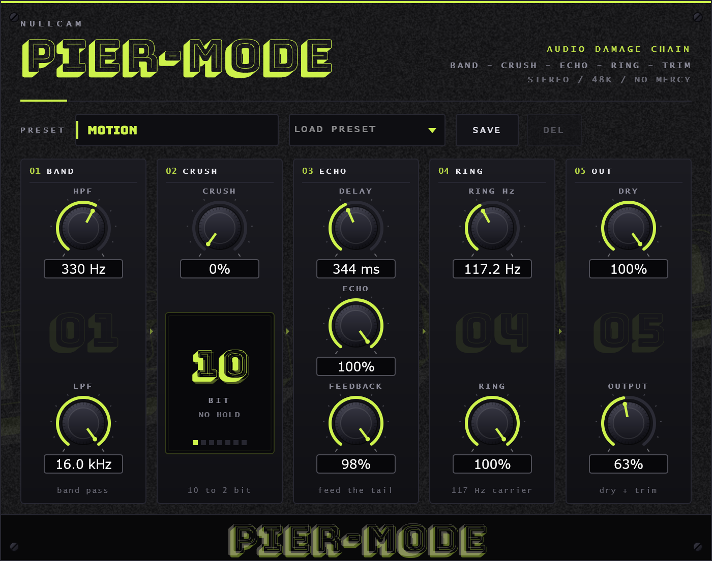

# PIER-MODE — VST3



The audio damage of the NULLCAM app, rebuilt as a plugin for Ableton Live (and any
VST3 host). It is the chain of `renderAudioOffline()` from `src/main.js`, with the
same topology, the same filter shapes and the same derived amounts.

```
input ──┬─────────────────────────────────────────────────► DRY ──┐
        └─► HPF ─► LPF ─► CRUSH ─┬─► DELAY + FEEDBACK ─► ECHO ────┤
                                  └─► RING MOD ────────────────────┴─► OUTPUT ─► out
                                                            (sample & hold last)
```

The dry branch bypasses everything before the mixer, exactly like the app: that is
why a crushed take still keeps a clean core and why the effect reads as "damage on
top of the sound" instead of a replacement.

## Parameters

| Knob      | Range          | App default | What it does |
|-----------|----------------|-------------|--------------|
| HPF       | 70 – 1200 Hz   | 330 Hz      | first filter, cuts the body |
| LPF       | 350 – 16000 Hz | 16 kHz      | second filter, muffles the top |
| CRUSH     | 0 – 1          | 0           | bit depth 10→2 bits plus sample hold from 0.3 up |
| DELAY     | 80 – 1600 ms   | 344 ms      | echo time |
| ECHO      | 0 – 1          | 1           | amount of the echo branch |
| FEEDBACK  | 0 – 0.98       | 0.978       | how long the repeats last |
| RING Hz   | 38 – 400 Hz    | 117.2 Hz    | carrier of the ring modulator |
| RING      | 0 – 1          | 1           | ring depth |
| DRY       | 0 – 1          | 1           | untouched signal into the mixer |
| OUTPUT    | 0.1 – 2        | 0.625       | final trim |

The defaults are the values the app produces for **MOTION EXTRACT** with its stock
parameters. Two of them are computed by the app rather than set by hand, and here
they are separate knobs so you can go further: `FEEDBACK = echo·0.95 + delay·0.08`
(0.978 in the app) and `OUTPUT = 1/(1+wet·0.6)` (0.625).

## Factory buttons

- **MOTION** — HPF 330, LPF 16k, no crush, 344 ms, echo 1, fb 0.978, ring 117.2, out 0.625.
  This is `fxSnapshot()` for `motion` with delay 2, gain 3, audio 0.4.
- **SORT** — HPF 436, LPF 13.4k, crush 0.65, ring 60 Hz at 0.35, no echo. From `sort`
  with mix 1 and low 0.32.
- **CLEAN** — filters open, everything else off, unity gain. The reference sound.

## The faceplate

The editor is one fixed card, printed like a boutique pedal: matte black paper with a
grain, acid-lime screen print, knurled metal knobs, and the wordmark set in **Bungee
Shade** both in the header and as a printed band along the bottom edge. The two fonts
travel inside the binary (SIL OFL, see `Source/Fonts`), so the panel is identical on
every machine and in every host.

Five cards, left to right in signal order — `BAND`, `CRUSH`, `ECHO`, `RING`, `OUT` —
with the hops marked between them. The CRUSH card carries a live readout of the bit
depth and the sample-and-hold factor, because those are the numbers you cannot see on
a knob.

Every knob is a real control, not a picture:

- drag up/down or use the wheel to sweep (about 450 px for the full range)
- **double click** the value box, type `412 Hz`, `16k`, `344 ms`, `42%` and press
  return: the value is set exactly, which is the fast way to dial in a frequency
- double click on the knob resets it to the parameter default
- the box under every knob always shows the unit, so `0.978` reads as `98%`

## Presets

Factory sounds: `MOTION`, `SORT`, `CLEAN`. The plate shows the one you are on and adds
a `*` when a knob has moved; when a project is reopened the name is read back off the
values, so the plate is honest after a restart.

User presets are one XML file each:

- **Windows** — `%APPDATA%\NULLCAM\PIER-MODE\presets`
- **macOS** — `~/Library/Application Support/NULLCAM/PIER-MODE/presets`

`SAVE` asks for a name and writes every parameter (raw values, not the normalised
ones, so a preset stays meaningful if a range is widened later). `DEL` removes the
selected user preset from disk. Host save (Live's project) is independent of all this,
so a set always reopens with the sound it had.

## Ottenere il .vst3 senza compilare

Il workflow `.github/workflows/build-vst3.yml` compila per macOS (universale) e Windows
x64 su GitHub e produce due zip pronti da inviare. Dopo aver messo il progetto su un
repository GitHub:

- **Senza tag** — dalla tab *Actions*, scegli *build-vst3* → *Run workflow*. A fine corsa
i due zip sono in *Artifacts* (scarico riservato a chi ha accesso al repo).
- **Con tag** — `git tag v1.0.0 && git push --tags`. I due zip vengono allegati a una
**Release**, quindi ottieni URL pubblici tipo
`https://github.com/<tuo-utente>/<repo>/releases/download/v1.0.0/PIER-MODE-macOS-VST3.zip`
da mandare a chi vuoi, senza account.

Ogni zip contiene `PIER-MODE.vst3` e `LEGGIMI - installazione.md`, cioè le istruzioni
per chi lo riceve (macOS, Windows, Ableton, sblocco Gatekeeper).

## Build (il modo rapido)

Hai CMake, quindi ti servono solo due comandi. Dalla cartella `vst/`:

- **Windows** — doppio clic su `build-windows.bat`. Configura, compila e lascia in
  `vst/` il file `PIER-MODE-Windows-VST3.zip` pronto da mandare.
- **macOS** — `chmod +x build-macos.sh && ./build-macos.sh`. Stesso risultato:
  `PIER-MODE-macOS-VST3.zip`.

Serve Visual Studio 2022 con il carico *Sviluppo di applicazioni desktop con C++*
(Windows) oppure Xcode Command Line Tools (macOS), più `git`: JUCE viene scaricato al
primo configure, qualche centinaio di MB una volta sola. Se hai già JUCE sul disco,
aggiungi `-DJUCE_DIR=/percorso/JUCE` e salti il download.

Il plugin viene copiato subito in una cartella VST3, senza che il build si interrompa:
`C:\Program Files\Common Files\VST3` se la console ha i permessi di amministratore,
altrimenti `%LOCALAPPDATA%\Programs\Common\VST3`. Per forzare una cartella:
`cmake -B build -DPIER_MODE_VST3_DIR="C:/Program Files/Common Files/VST3"`.

## Build a mano

Requirements: CMake 3.22+, a C++17 compiler. JUCE is downloaded by CMake on the
first configure (a few hundred MB, once).

**macOS**

```bash
brew install cmake
cmake -B build -DCMAKE_BUILD_TYPE=Release
cmake --build build --config Release
```

`COPY_PLUGIN_AFTER_BUILD` puts the plugin straight into
`~/Library/Audio/Plug-Ins/VST3`. For the Audio Unit as well, uncomment the `AU`
entry under `FORMATS` in `CMakeLists.txt`.

**Windows**

```powershell
cmake -B build -G "Visual Studio 17 2022" -A x64
cmake --build build --config Release
```

The plugin is copied after the build into the system VST3 folder
(`%COMMONPROGRAMFILES%\VST3`) when the shell is elevated, otherwise into
`%LOCALAPPDATA%\Programs\Common\VST3`, which needs no administrator rights. Override
it with `-DPIER_MODE_VST3_DIR=<folder>`. The uninstalled bundle is always at
`build/NullcamChain_artefacts/Release/VST3/PIER-MODE.vst3`.

**Then in Ableton Live:** Settings → Plug-Ins → *Use VST3 Plug-In System Folders* and,
if the per-user folder was used, add it as the *VST3 Plug-In Custom Folder* → Rescan.
Drag *PIER-MODE* on an audio track.

## Verify the sound without a host

The DSP is framework free, so it can be measured on its own:

```bash
g++ -O2 -std=c++17 tests/dsp_test.cpp -o dsp_test && ./dsp_test
```

It checks the high pass, the low pass, both ring sidebands, the echo landing at the
delay time, the crush level count and unity gain with clean settings. All seven
checks pass as of this commit.

There is also a dev-only tool that opens the real editor without a DAW, writes it to
a PNG and checks the preset round trip:

```
cmake --build build --config Release --target nullcam_ui_check
./build/nullcam_ui_check_artefacts/Release/nullcam_ui_check panel.png 2
```

The `2` is a render scale (useful on a HiDPI screen). It prints every child control
with its bounds and printed value, so a knob that never got a size shows up as `0 0 0 0`.

## What this plugin does not do

- **No parameter animation over time.** The app samples the effect state along the
  recording and interpolates it into the clip; here you automate the knobs in Live
  instead, which is the same thing done by hand.
- **No link to the video.** The `audio drive` of the app only moves pixels; there is
  no equivalent in the plugin because there is no picture.
- **No realtime processing in the app.** NULLCAM renders the damage offline after the
  take; the plugin does it live, sample by sample, which for these stages is
  equivalent (nothing here is look-ahead).
