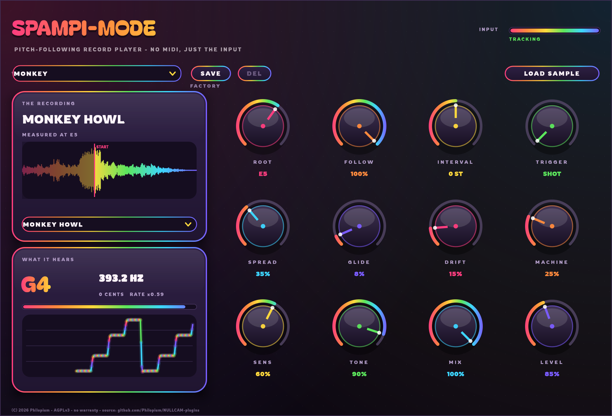

# SPAMPI-MODE

**Pitch-following record player VST3 by NULLCAM.** Nessun MIDI: entri con la chitarra
(e con qualunque cosa che abbia una nota) e il plugin suona **una registrazione vera**
alla velocità che le note chiedono.



---

## Cosa fa

Il plugin ascolta l'ingresso, misura la nota che stai suonando e la usa come se fosse
un pickup MIDI: `rate = 2^((nota - ROOT + INTERVAL + ottava casuale + drift) / 12)`.
La registrazione caricata viene letta a quella velocità con interpolazione Catmull-Rom,
quindi suonare un'ottava sopra fa correre il nastro al doppio, un'ottava sotto a metà.

La registrazione **non è un'oscillatore**: sono dodici registrazioni CC0 scaricate da
Freesound (scimmia, ambulanza, neonato, gatto, cane, water, treno, risata, elefante,
mucca, gallo, apertura di una scatoletta di SPAM) più quello che carichi tu.
L'elenco completo, con autore e pagina di ogni suono, è in [SAMPLES.md](SAMPLES.md).

Sotto il cofano:

| Parte | Come |
|---|---|
| pitch detection | autocorrelazione via FFT (YIN), finestra 2048 campioni, hop 256, 65-1600 Hz, interpolazione parabolica |
| playback | fase frazionaria + Hermite a 4 punti, glide esponenziale |
| attacco | la registrazione viene **tagliata nel suo punto di picco**: la nota parte lì, non dall'inizio del file |
| modalità | `SHOT` (un colpo per nota, tagliato sul picco, suona una volta), `LOOP` (il nastro gira), `GATE` (suona solo mentre c'è nota), `TRIG` (riparte da capo ad ogni cambio di nota) |
| MACHINE | drive + soft clip + bitcrush + grit |
| latenza | nessun buffer di ritardo: la nota viene misurata sull'ingresso, il sample parte subito |

Ogni registrazione viene analizzata quando la carichi: il plugin trova la finestra più
forte (20 ms) e segna quel punto come **inizio**. La forma d'onda nel pannello mostra il
taglio con la linea `START`: tutto quello che sta a sinistra è la sala, il respiro, il
silenzio prima del suono, e non viene suonato. Così l'attacco della nota cade sul picco
del sample (l'urlo, l'abbaio, lo scarico) e non su mezzo secondo di niente.

## I controlli

**LA REGISTRAZIONE**

| Comando | Cosa fa |
|---|---|
| box `SAMPLE` | sceglie la registrazione (prima le dodici factory, poi le tue) |
| `LOAD SAMPLE` | importa un file (`wav`, `aif`, `flac`, `ogg`, `mp3`): viene copiato nella tua cartella sample, misurato e selezionato |
| `ROOT` | la nota a cui la registrazione suona alla sua velocità naturale: si aggiorna da sola quando scegli una registrazione (è la nota misurata, scritta accanto al nome) |

**FOLLOW** - quanto la chitarra comanda la velocità: a 0% il nastro resta fermo, a
100% segue le note esatte.

**INTERVAL** - trasposizione fissa da -24 a +24 semitoni, somma al follow.

**TRIGGER** - `SHOT` (default), `LOOP`, `GATE`, `TRIG`.

- `SHOT` - **una nota, un colpo**. Ogni attacco fa partire la registrazione dal punto di
  picco, una volta sola; quando il sample finisce, silenzio. La velocità viene decisa
  sull'attacco e resta ferma per tutto il colpo: si sente un animale che suona, non un
  nastro che si allunga. Per far ripartire il colpo devi lasciare andare la nota (o
  cambiarla).
- `LOOP` - il nastro gira senza fine e la velocità lo piega di continuo.
- `GATE` - suona solo mentre l'ingresso è sopra la soglia.
- `TRIG` - riparte dal picco ad ogni cambio di nota.

**SPREAD** - probabilità che una nota venga spostata di un'ottava (su o giù) per
rompere la monotonia: 0% sempre lineare, 100% sempre imprevedibile.

**GLIDE** - portamento: quanto ci mette la testina ad arrivare alla nuova velocità.

**DRIFT** - deriva lenta della velocità, come un nastro consumato.

**MACHINE** - il carattere: drive, soft clip, bitcrush e ruvidità.

**SENS** - soglia del gate e fiducia minima perché una nota venga creduta.

**TONE** - filtro passa-basso sull'uscita.

**MIX** - dry (la tua chitarra) / wet (la registrazione).

**LEVEL** - gain finale.

Il pannello mostra anche: la forma d'onda della registrazione scelta con la linea `START`
dove il sample viene tagliato, la nota che sta sentendo in grande con Hz e cents, la barra
di confidenza, il rate di riproduzione, e una traccia delle ultime note come nastro rainbow.

## Preset

- **Factory**: `MONKEY`, `WEE-OO`, `BABY`, `MEOW STACK`, `GOOD BOY`, `FLUSH`,
  `NIGHT TRAIN`, `EVIL LAUGH`, `TRUMPET`, `MOO`, `ROOSTER`, `SPAM`.
- **Utente**: `SAVE` scrive un file XML per preset nella cartella preset, `DEL` lo
  cancella. Il progetto DAW salva automaticamente tutto, registrazione compresa
  (per percorso, così un sample tuo resta agganciato anche se cambia posizione
  nella lista).

## Cartelle

```
Windows   %APPDATA%\NULLCAM\SPAMPI-MODE\presets
          %APPDATA%\NULLCAM\SPAMPI-MODE\samples
macOS     ~/Library/Application Support/NULLCAM/SPAMPI-MODE/presets
          ~/Library/Application Support/NULLCAM/SPAMPI-MODE/samples
```

Metti un `.wav` dentro `samples` e riapri il plugin: compare nella lista. Oppure usa
`LOAD SAMPLE`, che lo copia lì per te.

## Build

Serve Visual Studio 2022 (carico "Sviluppo di applicazioni desktop con C++"), CMake e
un checkout di JUCE (scaricato al primo configure).

```bat
build-windows.bat
```

oppure a mano:

```bat
cmake -B build -G "Visual Studio 17 2022" -A x64
cmake --build build --config Release --target SpampiMode_VST3
```

Con JUCE già presente:

```bat
cmake -B build -G "Visual Studio 17 2022" -A x64 -DJUCE_DIR=C:\percorso\JUCE
```

Il `.vst3` viene copiato automaticamente nella cartella VST3 scrivibile: quella di
sistema se il build gira come amministratore, altrimenti
`%LOCALAPPDATA%\Programs\Common\VST3`.

## Test

```bat
cmake --build build --config Release --target spampi_dsp_test
build\Release\spampi_dsp_test.exe
```

Controlla il follower e il motore senza host: E2/D3/A3/E4/E5 misurate, rate che segue
la nota, FOLLOW a zero, INTERVAL, gate, note event, soft clip, mute, MIX 0 come
passthrough, resample, taglio sul picco, SHOT che suona una volta sola, helper del pannello.

Per vedere il pannello senza DAW (e verificare campioni, preset e importazione):

```bat
cmake --build build --config Release --target spampi_ui_check
build\spampi_ui_check_artefacts\Release\spampi_ui_check.exe panel.png 2
```

## Struttura

```
Source/SpampiEngine.h      motore: FFT/YIN, lettura Hermite, modi, nessuna dipendenza da JUCE
Source/PluginProcessor.*   parametri, caricamento campioni, root automatico, preset XML
Source/PluginEditor.*      il pannello
Source/Samples/            le dodici registrazioni CC0 (vedi SAMPLES.md)
Source/Fonts/              Bagel Fat One, Rowdies Bold/Regular, Titan One (SIL OFL)
tests/dsp_test.cpp         test del motore
tests/ui_check.cpp         render del pannello + round trip preset/sample
tools/fetch-samples.py     riscarica e riconverte i campioni (Freesound, solo CC0)
tools/make-samples-doc.py  rigenera SAMPLES.md da tools/samples.json
```

## Note

- Il sample misurato a metà: `ROOT` è la nota mediana della registrazione, quindi la
  macchina parte già in tono. Se una registrazione non ha una nota (una risata, uno
  scarico) il root viene stimato dalla brillantezza del suono: resta comunque suonabile.
- `MIX = 0` è un passthrough pulito: serve per verificare il dry.
- Il thread audio non tocca mai la lista dei campioni: legge solo gli slot atomici che
  il thread del messaggio pubblica, quindi importare un sample mentre suoni è sicuro.
- I campioni sono CC0 (pubblico dominio) e possono viaggiare dentro il plugin; i font
  sono SIL OFL. Vedi `SAMPLES.md` e `Source/Fonts/OFL.txt`.
